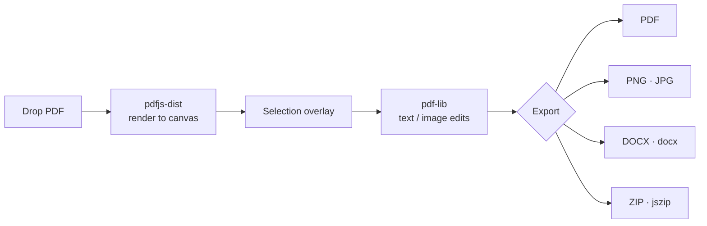

<div align="center">

# 🌌 Nebula PDF

**A private, in-browser PDF editor. Your files never leave your device.**


[Features](#-features) · [How it works](#-how-it-works) · [Run it](#-run-it) · [Türkçe](#-türkçe)

</div>

---

Nebula PDF is a fast, glassmorphism-styled PDF toolkit that runs **entirely client-side**.
Drop a file in, select a region and edit. No uploads, no servers, no accounts.

## ✨ Features

| Tool | What it does |
|---|---|
| 👁️ **View** | Smooth page rendering with pdf.js (worker-based) |
| ✏️ **Edit text** | Select an area and replace or add text |
| 🧽 **Remove images** | Select and erase images or regions on a page |
| 🖼️ **Extract as image** | Export pages as **PNG / JPG** at a chosen quality |
| 📄 **Convert to Word** | Generate a `.docx` from the document's text |
| 📦 **Batch export** | Bundle multi-page exports into a ZIP |

Everything is processed in memory in your browser, so it's safe for confidential documents.

## 🧩 How it works



## 🚀 Run it

```bash
npm install
npm run dev       # http://localhost:5173
npm run build     # production build in dist/
```

## 📁 Project structure

```
src/
├── components/   FileDropzone, PDFViewer, SelectionOverlay, TextEditTool,
│                 ImageRemovalTool, ExportTool, Sidebar, GlassCard, NeonButton
├── utils/        pdfHelper (load/render), pdfExporter (PDF/PNG/JPG), pdfToDocx
└── App.jsx
public/pdf.worker.min.mjs
```

## 🇹🇷 Türkçe

**Nebula PDF**, tamamen tarayıcıda çalışan, gizlilik odaklı bir PDF düzenleyicidir. Dosyalar hiçbir sunucuya
gönderilmez. PDF görüntüleme, metin düzenleme, görsel silme, sayfaları PNG/JPG olarak çıkarma ve Word'e (.docx)
dönüştürme özellikleri sunar. React, Vite, Tailwind, pdf.js ve pdf-lib ile geliştirilmiştir.

---

<div align="center"><sub>Built by <a href="https://github.com/Soap2647">Mert Yasin Yılmaz</a></sub></div>
